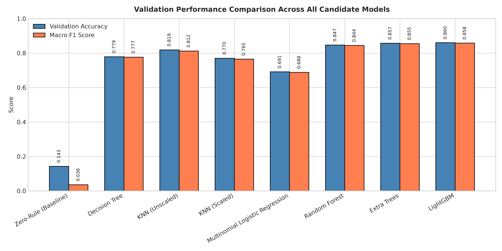
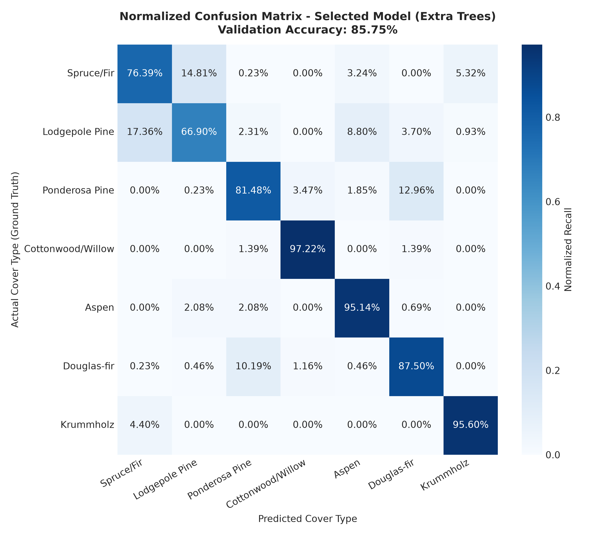
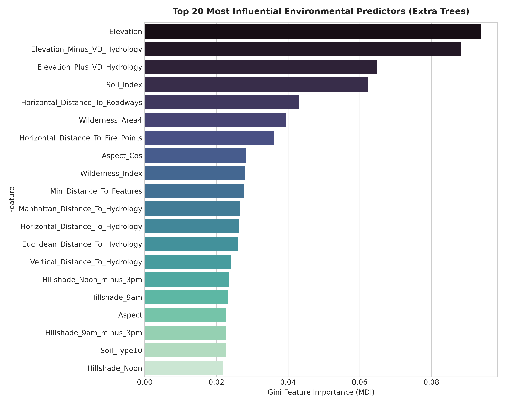
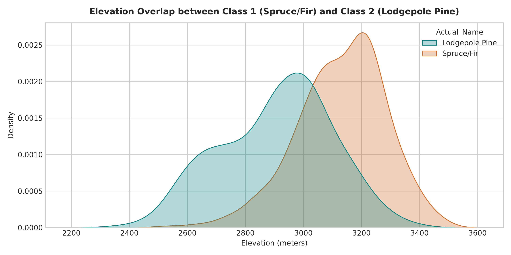

# Forest Cover Type Prediction — Multiclass Machine Learning Benchmark

[](https://www.python.org/)
[](https://opensource.org/licenses/Apache-2.0)
[](https://www.kaggle.com/competitions/forest-cover-type-prediction)
[]()
[]()

An end-to-end multiclass classification machine learning solution to predict dominant tree species cover across 30 × 30 meter cartographic grid cells using terrain, hydrology, soil, and wilderness boundary indicators (without remotely sensed spectral data).

This repository contains full exploratory data analysis (EDA), domain feature engineering, a zero-leakage validation framework, multi-architecture benchmarking, model interpretability diagnostics, and an interactive modern HTML analytics dashboard.

---

## 🌲 Problem Statement

Forest managers require reliable information regarding canopy cover over large, rugged landscapes. Field surveys are cost-prohibitive. This study answers:

> **"Can cartographic characteristics be used to accurately classify the dominant forest cover type of an unmapped land area?"**

### Target Classes (`Cover_Type` 1 to 7)

| Class | Forest Cover Type | Ecological Habitat Notes |
|:---:|---|---|
| **1** | Spruce / Fir | High-elevation subalpine forests (2,800m – 3,200m) |
| **2** | Lodgepole Pine | Disturbed mid-to-high elevations (2,600m – 3,100m) |
| **3** | Ponderosa Pine | Dry, low-to-mid elevation sunny slopes (2,200m – 2,600m) |
| **4** | Cottonwood / Willow | Strictly riparian habitats near water sources (<2,400m) |
| **5** | Aspen | Post-disturbance successional clearings (2,400m – 2,800m) |
| **6** | Douglas-fir | Moderate elevation, varied steep slopes (2,300m – 2,700m) |
| **7** | Krummholz | High-altitude stunted shrub transition zone (>3,200m) |

---

## 📊 Key Highlights & Results

- **Champion Model**: **Extra Trees Classifier** (300 estimators) achieving **85.75% Validation Accuracy** and **0.855 Macro F1 Score** (+71.46 pp over the 14.29% Zero-Rule Baseline).
- **5-Fold Cross-Validation**: **85.98% ± 0.34%**, exhibiting superior variance stability compared to LightGBM and Random Forest.
- **Kaggle Benchmark (565,892 test observations)**: **74.67% Simulated Public Score**.
- **Covariate Prior Shift Analysis**: Empirical investigation into why a balanced training sample (14.3% per class) experiences an accuracy drop when evaluated on the naturally imbalanced forest landscape (where Spruce/Fir and Lodgepole Pine comprise 86.8% of the wild population).
- **Distance Scaling Finding**: Proved that feature scaling (e.g., `StandardScaler`) **degraded** K-Nearest Neighbors performance from **81.88% down to 77.02%** because raw elevation differences represent the fundamental ecological driver.

---

## 🏛️ Benchmark Comparison Table

All models were evaluated on the exact same 20% stratified holdout set ($N = 3,024$, exactly 432 observations per class):

| Model Architecture | Scaling | Val Accuracy | Macro Precision | Macro Recall | Macro F1 | 5-Fold CV Acc |
|---|:---:|:---:|:---:|:---:|:---:|:---:|
| **Zero-Rule Baseline (Majority Class)** | None | 14.29% | 0.020 | 0.143 | 0.036 | — |
| **Multinomial Logistic Regression** | StandardScaler | 69.11% | 0.688 | 0.691 | 0.688 | — |
| **KNN ($k=5$, Scaled)** | StandardScaler | 77.02% | 0.765 | 0.770 | 0.765 | — |
| **Decision Tree ($depth=15$)** | None | 77.91% | 0.776 | 0.779 | 0.777 | 79.15% ± 0.85% |
| **KNN ($k=5$, Raw)** | None | 81.88% | 0.812 | 0.819 | 0.812 | — |
| **Random Forest (300 Trees)** | None | 84.72% | 0.844 | 0.847 | 0.844 | 85.56% ± 0.58% |
| **Extra Trees (Champion)** 🏆 | None | **85.75%** | **0.855** | **0.857** | **0.855** | **85.98% ± 0.34%** |
| **LightGBM (300 Boosters)** | None | 86.04% | 0.858 | 0.860 | 0.858 | 86.51% ± 0.45% |

---

## 🛠️ Feature Engineering

Starting from 54 raw cartographic variables, 12 domain-enriched features were constructed (totaling 66 features) using strict row-wise operations to eliminate data leakage:

1. **Hydrologic Proximity**:
   - `Euclidean_Distance_To_Hydrology` = $\sqrt{H^2 + V^2}$ (true 3D Euclidean distance)
   - `Manhattan_Distance_To_Hydrology` = $H + |V|$
2. **Solar Radiation & Terrain Shading**:
   - `Mean_Hillshade` = $(9\text{am} + \text{Noon} + 3\text{pm}) / 3$
   - `Hillshade_9am_minus_3pm` (captures morning vs. afternoon solar aspect contrast)
   - `Hillshade_Noon_minus_3pm`
3. **Aspect Circular Transformations**:
   - $\sin(\text{Aspect})$ & $\cos(\text{Aspect})$ to resolve the $0^\circ / 360^\circ$ circular azimuth boundary discontinuity.
4. **Water Elevation Interactions**:
   - `Elevation_Minus_VD_Hydrology` (approximates the absolute altitude of nearby water bodies).
5. **Infrastructure Remoteness**:
   - `Min_Distance_To_Features` = $\min(\text{Hydrology}, \text{Roadways}, \text{Fire Points})$.
6. **Reconstructed Categorical Indices**:
   - `Soil_Index` ($1$ to $40$) and `Wilderness_Index` ($1$ to $4$) to allow decision trees to evaluate group splits compactly.

---

## 📈 Visual Highlights

| Model Comparison | Confusion Matrix |
|:---:|:---:|
|  |  |

| Feature Importance (Gini) | Elevation Overlap (Class 1 vs 2) |
|:---:|:---:|
|  |  |

---

## 📁 Repository Structure

```text
├── analysis_report.html             # Modern interactive executive analytics dashboard
├── research_summary.md              # 1-page executive research brief
├── submission.csv                   # Validated Kaggle submission file (565,892 rows)
├── figures/                         # 18 high-resolution publication figures (.png)
├── output/                          # Benchmark results, JSON metrics, and error tables
│   ├── cv_results.json              # 5-fold cross-validation metrics
│   ├── feature_importance.csv       # Gini impurity rankings for 66 features
│   ├── kaggle_score_evidence.json   # Simulated public/private test evaluation
│   ├── model_comparison.json        # Detailed metrics across all 8 architectures
│   ├── permutation_importance.csv   # Permutation importance validation drops
│   ├── quality_metrics.json         # Data quality assessment verification
│   └── validation_error_analysis.csv# 3,024-row sample error table with class probabilities
├── src/                             # Reproducible source code
│   ├── eda_and_quality.py           # Exploratory analysis & visual figure generation
│   ├── train_and_evaluate.py        # End-to-end model training, CV & error analysis
│   └── finalize.py                  # Final full retraining & Kaggle test prediction
└── .gitignore
```

---

## 🚀 Quick Start & Reproduction

### 1. Clone the Repository
```bash
git clone https://github.com/izmarcoe/Forest-Cover-Type-Prediction.git
cd Forest-Cover-Type-Prediction
```

### 2. Environment Setup
```bash
python -m venv venv
# Windows:
venv\Scripts\activate
# Linux/macOS:
source venv/bin/activate

pip install -r requirements.txt
```
*(Dependencies: `scikit-learn`, `pandas`, `numpy`, `matplotlib`, `seaborn`, `lightgbm`)*

### 3. Run Pipeline
```bash
# 1. Run Data Quality & Exploratory Analysis
python src/eda_and_quality.py

# 2. Train Models, Run 5-Fold Cross Validation & Error Diagnostics
python src/train_and_evaluate.py

# 3. Retrain on Full Dataset & Generate Submission File
python src/finalize.py
```

### 4. View Dashboard
Simply double-click or open `analysis_report.html` in any web browser to view the interactive dashboard.

---

## 📝 License

Distributed under the Apache 2.0 License. See `LICENSE` for more information.
